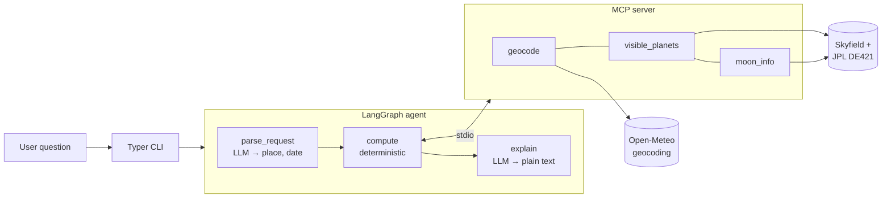

# sky-tonight-concierge

Ask what you can see in the night sky from anywhere, in plain language:

```bash
sky-tonight "what can I see tonight from Lisbon"
```

You get back a short plan: which planets are up and where to look, the Moon's phase and how much its light will get in the way, and a good time to go out.

**Who it's for:** curious people with no telescope and no astronomy background. It's also a small, readable example of an agent built with LangGraph and MCP.

> Status: Milestone 1. Planets and the Moon only. Weather, ISS passes, bright stars and more are planned in [ROADMAP.md](ROADMAP.md).

## How it works



- **The LLM only handles language.** It reads your question into a place and an optional date, then writes the explanation. All astronomy is deterministic Python.
- **The MCP server** (`sky-tonight-mcp`, official MCP Python SDK) exposes the domain tools. The agent starts it as a subprocess and calls it through `langchain-mcp-adapters`. You can also connect any other MCP client to it.
- **Sky positions** come from [Skyfield](https://rhodesmill.org/skyfield/) with the JPL DE421 ephemeris. The ephemeris is downloaded once (about 17 MB) to `~/.cache/sky-tonight`. The sky is sampled at 22:00 local time on the requested date.

## Stack

Python 3.12, uv, LangGraph, LangChain (`init_chat_model`), MCP Python SDK, langchain-mcp-adapters, Skyfield, httpx, Pydantic, Typer, pytest, respx, ruff.

## Running it

You need [uv](https://docs.astral.sh/uv/) and an OpenAI API key.

```bash
git clone https://github.com/csavva/sky-tonight-concierge.git
cd sky-tonight-concierge
uv sync --extra openai
cp .env.example .env          # then put your OPENAI_API_KEY in .env
uv run sky-tonight setup      # optional: download the ephemeris now
uv run sky-tonight "what can I see tonight from Lisbon"
uv run sky-tonight "what's up from São Paulo on 2026-12-24"
```

## Configuration

All configuration is read from environment variables, or from `.env`:

| Variable | Default | Purpose |
| --- | --- | --- |
| `LLM_MODEL` | `openai:gpt-6-luna` | Model as `provider:model`, passed to LangChain's `init_chat_model` |
| `OPENAI_API_KEY` | none | Required for the OpenAI provider |
| `SKY_TONIGHT_CACHE` | `~/.cache/sky-tonight` | Where the ephemeris is stored |

Only OpenAI is supported for now, but you can switch to any OpenAI model by changing `LLM_MODEL`, e.g. `LLM_MODEL=openai:gpt-5.4-mini`. Anthropic and Gemini support, and Langfuse tracing, are planned for Milestone 4.

## Running the MCP server on its own

```bash
uv run sky-tonight-mcp
```

This speaks MCP over stdio. To try the tools interactively, use the MCP Inspector:

```bash
npx @modelcontextprotocol/inspector uv run sky-tonight-mcp
```

Claude Desktop setup instructions are planned for Milestone 5.

## Development

```bash
uv sync --all-extras
uv run ruff check . && uv run ruff format --check .
uv run pytest
uv run pytest tests/test_sky.py::test_moon_info_full_moon -q
```

The tests are deterministic:
- Astronomy tests use a fixed place and date (Lisbon, June 2026) and the real ephemeris.
- HTTP calls are mocked with respx.
- The graph test uses a fake chat model, so no API key or network access is needed. The ephemeris is the only download.

## License

MIT, see [LICENSE.md](LICENSE.md).
